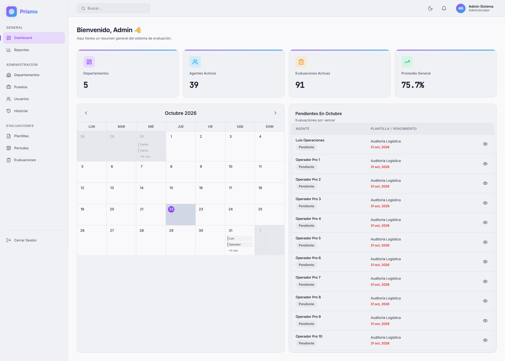
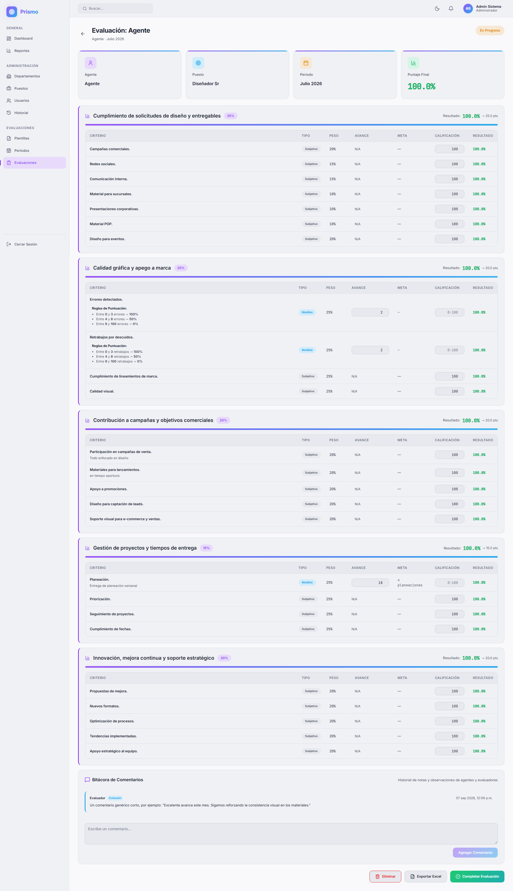

<div align="center">

# 📊 Prismo

**Sistema de evaluación de KPIs para equipos de alto rendimiento**

Define plantillas de evaluación con categorías y criterios ponderados, asigna evaluaciones por período
y da seguimiento al desempeño de cada agente con reportes y gráficas.


</div>

---

## 🖼 Capturas

**Dashboard**



**Detalle de evaluación**



---

## 📑 Contenido

- [Características](#-características)
- [Capturas](#-capturas)
- [Tecnologías](#-tecnologías)
- [Estructura del proyecto](#-estructura-del-proyecto)
- [Requisitos](#-requisitos)
- [Instalación](#-instalación)
- [Variables de entorno](#-variables-de-entorno)
- [Scripts disponibles](#-scripts-disponibles)
- [Roles de usuario](#-roles-de-usuario)
- [API](#-api)
- [Diseño responsive y PWA](#-diseño-responsive-y-pwa)
- [Cómo contribuir](#-cómo-contribuir)

---

## ✨ Características

- **Plantillas de evaluación** con categorías y criterios ponderados (los pesos deben sumar 100 %).
- **Criterios subjetivos y medibles**: los medibles tienen meta y unidad.
- **Períodos de evaluación** con estados: borrador, activo y cerrado.
- **Asignación automática** de evaluaciones mensuales según la frecuencia de la plantilla.
- **Flujo de evaluación**: el agente reporta su avance y sube evidencias; el jefe califica y cierra.
- **Bitácora de comentarios** en cada evaluación.
- **Dashboard** con indicadores y calendario de vencimientos.
- **Reportes** por equipo y por agente, con gráficas de tendencia y radar.
- **Exportación a Excel** de evaluaciones y reportes.
- **Notificaciones** dentro de la aplicación.
- **Historial de auditoría** de los cambios importantes.
- **Modo claro / oscuro**.
- **Diseño responsive** e **instalable como app (PWA)**.

---

## 🛠 Tecnologías

| Capa | Tecnología |
|---|---|
| **Frontend** | React 18, Vite 5, React Router 6, Framer Motion, Recharts, ExcelJS, Lucide Icons |
| **Backend** | Node.js, Express 4, JWT (`jsonwebtoken`), `bcryptjs`, Multer (subida de archivos) |
| **Base de datos** | MySQL (`mysql2`), pensado para XAMPP |
| **Estilos** | CSS propio con variables (sin frameworks) |

---

## 📁 Estructura del proyecto

```
Prismo/
├── backend/
│   ├── index.js              # Punto de entrada del servidor Express
│   ├── sql/schema.sql        # Esquema de la base de datos
│   ├── uploads/              # Evidencias subidas por los usuarios
│   └── src/
│       ├── config/           # Conexión a MySQL
│       ├── middleware/       # Autenticación, roles y subida de archivos
│       ├── routes/           # Definición de rutas /api/*
│       ├── handlers/         # Lógica de cada ruta
│       └── utils/            # Cálculo de puntajes, asignación automática, seeds
│
└── frontend/
    ├── index.html
    ├── vite.config.js        # Puerto de desarrollo y proxy hacia la API
    ├── public/               # Íconos, manifest.json y service worker (PWA)
    └── src/
        ├── api/              # Cliente HTTP (axios)
        ├── components/       # Layout (menú, barra superior) y componentes comunes
        ├── context/          # Sesión del usuario (AuthContext)
        ├── pages/            # Una página por sección de la app
        ├── utils/            # Exportación a Excel
        └── index.css         # Estilos globales y responsive
```

---

## 📋 Requisitos

- [Node.js](https://nodejs.org/) **18 o superior**
- [XAMPP](https://www.apachefriends.org/) (o cualquier servidor MySQL / MariaDB)
- Git

---

## 🚀 Instalación

### 1. Clonar el repositorio

```bash
git clone https://github.com/ACasillas1999/Prismo.git
cd Prismo
```

### 2. Base de datos

1. Inicia **MySQL** desde el panel de XAMPP.
2. Crea una base de datos vacía (por ejemplo `prismo`).
3. Importa el esquema `backend/sql/schema.sql` desde phpMyAdmin o con:

```bash
mysql -u root -p prismo < backend/sql/schema.sql
```

### 3. Backend

```bash
cd backend
npm install
```

Crea el archivo `backend/.env` (ver [Variables de entorno](#-variables-de-entorno)) y después:

```bash
npm run seed   # crea el usuario administrador inicial
npm run dev    # inicia la API con recarga automática
```

> ⚠️ **Cambia la contraseña del administrador inicial** en cuanto inicies sesión por primera vez.
> Las credenciales por defecto están en `backend/src/utils/seed.js`.

### 4. Frontend

En otra terminal:

```bash
cd frontend
npm install
npm run dev
```

Abre la URL que muestra la terminal (por defecto `http://localhost:5176`).

> Si la API corre en otra máquina o puerto, ajusta el `proxy` en `frontend/vite.config.js`.

---

## 🔐 Variables de entorno

Archivo `backend/.env`. **Nunca lo subas al repositorio.**

| Variable | Descripción | Ejemplo |
|---|---|---|
| `PORT` | Puerto de la API | `3010` |
| `MYSQL_HOST` | Servidor de MySQL | `localhost` |
| `MYSQL_PORT` | Puerto de MySQL | `3306` |
| `MYSQL_DB` | Nombre de la base de datos | `prismo` |
| `MYSQL_USER` | Usuario de MySQL | `root` |
| `MYSQL_PASS` | Contraseña de MySQL | *(la tuya)* |
| `JWT_SECRET` | Clave para firmar las sesiones. Usa una cadena larga y aleatoria | *(secreta)* |
| `JWT_EXPIRES_IN` | Duración de la sesión | `8h` |

---

## 📜 Scripts disponibles

**Backend** (`/backend`)

| Comando | Qué hace |
|---|---|
| `npm run dev` | Inicia la API con `nodemon` (se reinicia al guardar cambios) |
| `npm start` | Inicia la API en modo producción |
| `npm run seed` | Crea el usuario administrador inicial |

**Frontend** (`/frontend`)

| Comando | Qué hace |
|---|---|
| `npm run dev` | Servidor de desarrollo de Vite |
| `npm run build` | Genera la versión de producción en `dist/` |
| `npm run preview` | Sirve localmente la versión de producción |

---

## 👥 Roles de usuario

| Rol | Puede |
|---|---|
| **Administrador** | Todo: departamentos, puestos, usuarios, plantillas, períodos, evaluaciones, reportes e historial |
| **Jefe de departamento** | Plantillas, períodos y evaluaciones de su departamento; calificar y ver reportes |
| **Agente** | Ver sus evaluaciones, reportar avance, subir evidencias y comentar |

---

## 🔌 API

Todas las rutas (excepto el inicio de sesión) requieren el encabezado `Authorization: Bearer <token>`.

| Ruta base | Recurso |
|---|---|
| `/api/auth` | Inicio de sesión y sesión actual |
| `/api/departments` | Departamentos |
| `/api/positions` | Puestos |
| `/api/users` | Usuarios |
| `/api/templates` | Plantillas, categorías y criterios |
| `/api/periods` | Períodos de evaluación |
| `/api/evaluations` | Evaluaciones, calificaciones, evidencias y comentarios |
| `/api/dashboard` | Indicadores del dashboard |
| `/api/reports` | Reportes generales y por agente |
| `/api/notifications` | Notificaciones |
| `/api/audit` | Historial de auditoría |
| `/uploads/*` | Archivos de evidencia (estáticos) |

---

## 📱 Diseño responsive y PWA

- La interfaz se adapta a celulares (≤ 768 px): menú lateral desplegable, tablas con desplazamiento
  o en formato de tarjetas, filtros y botones a todo el ancho.
- Prismo se puede **instalar como aplicación** desde el navegador (Android e iOS).
  En la pantalla de inicio de sesión aparece una guía de instalación.

> ℹ️ La instalación como PWA **requiere HTTPS** (o `localhost`). En una red local por HTTP
> la aplicación funciona, pero el navegador no ofrecerá instalarla.

---

## 🤝 Cómo contribuir

1. Trabaja en tu propia copia del repositorio y mantenla al día con `git pull`.
2. Haz **un commit por cada cambio** terminado y probado.
3. Usa mensajes con el formato [Conventional Commits](https://www.conventionalcommits.org/es/):

| Tipo | Cuándo |
|---|---|
| `feat:` | Funcionalidad nueva |
| `fix:` | Corrección de un error |
| `style:` | Cambios solo visuales |
| `refactor:` | Reorganizar código sin cambiar su comportamiento |
| `docs:` | Documentación |

Ejemplo: `fix: tablas con scroll horizontal en móvil`

---

<div align="center">
<sub>Prismo — uso interno</sub>
</div>
